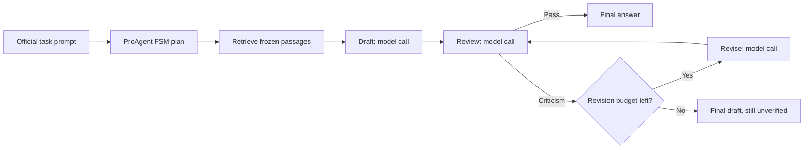

# BioProAgent runtime fixes and bounded benchmark profile

> Generated JSON reports and downloaded datasets are local artifacts excluded from Git.
> References and commands below use local report paths; Markdown summaries remain in the repository.

This follow-up patches the actual [public BioProAgent source](https://github.com/YuyangSunshine/bioproagent/tree/e18586ab4a2a851433bedc0e6940b77470355fd6).
It still executes `main_evaluate.ProAgent.process_query`, `AdaptivePlanner`, and
the upstream retrieval, drafting, reflection, and revision tools. The original
unmodified clone and [original 200-case results](bioprobench-upstream-proagent.md)
remain available. This is a patched public implementation applied to BioProBench,
not a reproduction of either paper's complete private agent implementation.

The reviewed [source patch](../apps/server/eval/bioprobench/patches/proagent-benchmark.patch)
is applied to a separate checkout at `/private/tmp/labee-proagent-fixed-source`.
The runner requires the pinned upstream revision and an exact match to this
patch. Without `--patched`, it continues to require unmodified upstream source.
The authors' [non-commercial research license and attribution requirements](https://github.com/YuyangSunshine/bioproagent/blob/e18586ab4a2a851433bedc0e6940b77470355fd6/Licenses.md)
apply. These changes are confined to the evaluation harness and external clone;
they are not incorporated into the production agent.

## Changes

| Observed failure | Fix in cloned source |
|---|---|
| 283 argument errors across 127 cases | Expose live LangChain JSON schemas instead of the release's generic tool-description paragraph. Bind omitted arguments from the current query and working memory; validate before invocation; block unresolved references. |
| 117 cases stopped by oscillation detection | Track state **and artifact/verdict fingerprints**. Normal review/revision transitions with changed drafts are progress. Stop after three identical snapshots, rather than counting repeated state names. |
| Criticism treated as tool execution failure | A completed review returning `status=fail` is a successful tool execution with negative verification. It routes to `RECTIFY_DRAFT`. Provider/runtime errors remain failures. |
| Old verification can apply to a new draft | Clear verification on each new/revised draft; bind the current verdict to a draft SHA-256. Ignore stale historical passes. |
| False verification passes | Match exact `done`, `pass`, or `ok` verdicts. Text such as `NOT PASS` remains criticism. Empty responses and exceptions cannot become passes. |
| QA/ORD/ERR answers expanded into generic SOPs | Known-task drafting and revision preserve the complete official question and answer format. Review and revision see the same frozen evidence. No gold answer is supplied. |
| 709 intent/planning calls out of 902 total calls | For explicitly configured benchmark tasks, route directly to task mode and use the upstream planner's existing canonical FSM plans. This removes redundant neural planning of a known tool sequence. General interactive mode retains neural planning. |
| Unbounded or ineffective retries | Stop benchmark trials on tool/provider failure; cap at two revisions; stop after a reviewed unchanged revision. Fix failed-tool counters and consecutive-failure accounting in the general loop. |

The benchmark configuration changes planning policy as well as repairing bugs.
It **does not retain the original neural planner calls**: it uses ProAgent's
state inference and canonical plans. Consequently, this comparison evaluates
the combined runtime/prompt/planning changes, not an isolated neural-planner or
reflection effect. The model still writes the draft, reviews it, and performs
any requested revisions through the real upstream tools.

For known text tasks, the normal path is:



Each successful first draft takes two calls. One revision plus review takes four;
two revisions plus reviews take six. A provider failure ends the trial immediately.
A draft that still fails review at the budget limit is reported with
`revision_budget_exhausted`, not silently relabeled as verified. No revision is
forced just to increase the revision count, and no gold-based rollback selects
which draft to score. The final artifact is scored as produced.

## Controlled comparison

- The same 200 question IDs: 50 each of PQA, ORD, ERR, and GEN.
- The same `claude-opus-5-5` model and CLI transport, with eight agent workers.
- Exact stored baseline evidence per question: Qwen3-Embedding-8B, FAISS
  `IndexFlatL2`, 60 dense candidates, 60/40 semantic/BM25 weighting, and
  task-specific chunk sizes/top-k. No new embeddings or retrieval ranking changes.
- Fresh independent agent memory for each case. No reference answers enter the
  agent; the official formatter supplies task inputs only.
- The four live smoke cases are included once in the full run, including the
  provider refusal. No replacement samples, refusal retries, or result cherry-picking.
- For each pair of arms, exclude a question if **either** arm had a provider
  biology refusal. Other failures remain zero. Pairwise denominators may differ.
  All-200 scores and exclusions remain available in the machine-readable report.
- QA/ORD/ERR use accuracy; GEN uses the existing evaluator's core token-overlap
  F1. GEN is not the paper's semantic step-recall metric. Known malformed ORD
  references remain zero under the pre-existing scoring policy.
- These are previously inspected development cases, not a fresh holdout. The
  combined patch and additional inference cannot establish isolated causal
  benefits from reflection or revision.

## Completed 200-case results

The runtime failures were eliminated and total model calls fell from **902 to
418 (53.7% fewer)**. The patched agent used **2.09×** the plain-RAG call count
of 200. It recovered much of the original agent's lost accuracy, but its small
advantages over plain RAG do not establish a general quality benefit.

| Execution measure, all 200 selected cases | Original agent | Patched agent |
|---|---:|---:|
| Cases with tool-argument errors | 127 | **0** |
| Argument-error events | 283 | **0** |
| Oscillation stops | 117 | **0** |
| Cases reaching review calls | 65 | **176** |
| Cases reaching and completing revision calls | 7 | **18** |
| Revision model calls | 7 | **21** |
| Total model calls | 902 | **418** |
| Provider refusals | 32 | 28 |
| Other provider/runtime errors | 0 | **0** |
| Median full model/tool-loop latency | 73.17 s | **22.21 s** |

The patched call breakdown is 200 draft calls, 197 review calls, and 21 revision
calls. There are no intent-classification or neural-planning calls in this
explicit benchmark profile. All 200 cases accessed their frozen evidence once.
Twenty-four cases stopped at drafting refusals and four at review refusals;
all 172 non-refused cases completed review. Of these, 170 ended with a reviewer
pass and two exhausted the revision budget while still failing review. There
were no no-progress or unchanged-revision stops. A reviewer pass is not a claim
that the benchmark answer is correct.

### Scores on the same cases across all three arms

Exclude a case if **any of the three arms** refused it. This gives one identical
question set for every column, rather than comparing different denominators.
The remaining malformed ORD references score zero as before.

| Task / metric | Matched N | Plain RAG | Original agent | Patched agent |
|---|---:|---:|---:|---:|
| QA accuracy | 48 | 81.25% | 47.92% | **81.25%** |
| ORD accuracy | 41 | 53.66% | 46.34% | **58.54%** |
| ERR accuracy | 44 | 75.00% | 65.91% | **75.00%** |
| GEN core token F1 | 34 | 0.2799 | 0.1062 | **0.2965** |

The comparison artifact also includes **pairwise** refusal-excluded results,
which retain more cases when the third arm alone refused:

| Patched minus plain RAG | Pairwise N | Difference | Paired bootstrap 95% interval |
|---|---:|---:|---:|
| QA accuracy | 48 | 0.00 percentage points | −8.33 to +8.33 pp |
| ORD accuracy | 43 | +4.65 percentage points | −4.65 to +13.95 pp |
| ERR accuracy | 45 | 0.00 percentage points | −8.89 to +8.89 pp |
| GEN core token F1 | 36 | +0.0167 | −0.0013 to +0.0367 |

All four intervals include zero. These intervals describe resampling this
previously inspected development set; they do not account for prompt tuning,
provider selection effects, repeated model draws, or generalization to fresh
questions. Original-to-patched QA and GEN gains are much larger; their paired
intervals exclude zero, while ORD and ERR intervals do not.

### What the revision loop contributed

Among the 18 revised cases, **8 improved, 7 worsened, and 3 were unchanged** by
the task metrics. This compares each case's first draft to its final artifact;
it does not compare a new draft against a separately sampled plain-RAG answer.

| Task | Revised cases | Improved / worsened / unchanged |
|---|---:|---:|
| QA | 0 | 0 / 0 / 0 |
| ORD | 3 | 0 / 0 / 3 |
| ERR | 2 | 2 / 0 / 0 |
| GEN | 13 | 6 / 7 / 0 |

Across all non-refused cases within each task, ERR increased from **71.11% to
75.56%** (two additional correct answers among 45), and GEN token F1 increased
from **0.2878 to 0.2908** among 36. QA and ORD scores were unchanged by revision.
The seven GEN regressions are token-overlap regressions, not adjudicated
scientific-quality regressions. The GEN metric can penalize useful wording or
content changes; the present experiment does not resolve that distinction.

Most recovery versus the original broken agent therefore comes from reliably
retrieving evidence, producing task-formatted drafts, and reaching the intended
control flow. More revision calls alone are not a success criterion. Before
expanding the agent, the next useful experiment is a fresh held-out, paired
comparison of task-aware drafting alone versus the same draft followed by
review/revision, with a prespecified call budget and a more informative GEN
quality measure. Keep plain RAG as the lower-cost baseline.

### Artifacts and checks

- Per-case evaluation (`bioprobench-proagent-fixes-evaluation.json`, local artifact): scores,
  exclusions, source references/hashes, model usage, and agent audit fields.
- Comparisons and execution summary (`bioprobench-proagent-fixes-comparison.json`, local artifact):
  both paired baselines, common-three-arm scores, confidence intervals, and
  first-draft-to-final effects.
- Full local checkpoints: `/private/tmp/labee-proagent-fixed-paper-50`.
- **28 distinct offline tests passed** across the retrieval and agent Python
  environments: 15 existing retrieval/report tests, four runner integration
  tests, and nine patched-source regression tests. The two original neural-path
  integration tests also passed against the patched clone with benchmark mode
  disabled.
- Validated all 200 unique IDs (50/task), exact baseline question/passages,
  per-call request hashes and model identity, the six-call cap, final review on
  every non-refused case, and stopping at the first provider failure.
- Runner and patch hashes still match the completed manifest; the original
  clone's tracked source remains unchanged. The patch applies cleanly to the
  pinned original source.

## Reproduce

From the worktree, after preparing the existing baseline artifacts:

```sh
git clone https://github.com/YuyangSunshine/bioproagent.git /private/tmp/labee-proagent-fixed-source
git -C /private/tmp/labee-proagent-fixed-source checkout e18586ab4a2a851433bedc0e6940b77470355fd6
git -C /private/tmp/labee-proagent-fixed-source apply "$PWD/apps/server/eval/bioprobench/patches/proagent-benchmark.patch"

BIOPROAGENT_FIXED_SOURCE=/private/tmp/labee-proagent-fixed-source \
  /private/tmp/labee-proagent-venv/bin/python -m unittest discover \
  -s apps/server/eval/bioprobench -p test_proagent_fixed.py -v

CLAUDE_BIN=/Users/martin/.local/bin/claude \
  /private/tmp/labee-proagent-venv/bin/python apps/server/eval/bioprobench/runProAgent.py \
  --agent-source /private/tmp/labee-proagent-fixed-source \
  --source /private/tmp/labee-bioprobench-research \
  --base /private/tmp/labee-bioprobench-nebius-paper-50 \
  --out /private/tmp/labee-proagent-fixed-paper-50 --patched --workers 8 --live

python3 apps/server/eval/bioprobench/report.py \
  --source /private/tmp/labee-bioprobench-research \
  --out /private/tmp/labee-proagent-fixed-paper-50 \
  --report docs/bioprobench-proagent-fixes-evaluation.json \
  --baseline-report docs/bioprobench-upstream-proagent-evaluation.json \
  --exclude-provider-refusals

python3 apps/server/eval/bioprobench/summarizeProAgent.py \
  --report docs/bioprobench-proagent-fixes-evaluation.json \
  --original docs/bioprobench-upstream-proagent-evaluation.json \
  --rag docs/bioprobench-nebius-paper-50-evaluation.json \
  --out docs/bioprobench-proagent-fixes-comparison.json
```

The model environment uses the existing
[`requirements-proagent.txt`](../apps/server/eval/bioprobench/requirements-proagent.txt).
The patch SHA-256 and runner SHA-256 are frozen in the run manifest. Do not edit
source or the runner during a live/resumed run. Full prompts, responses, and
traces stay outside Git in the output directory; shareable results contain only
scores, hashes, and execution metadata.
