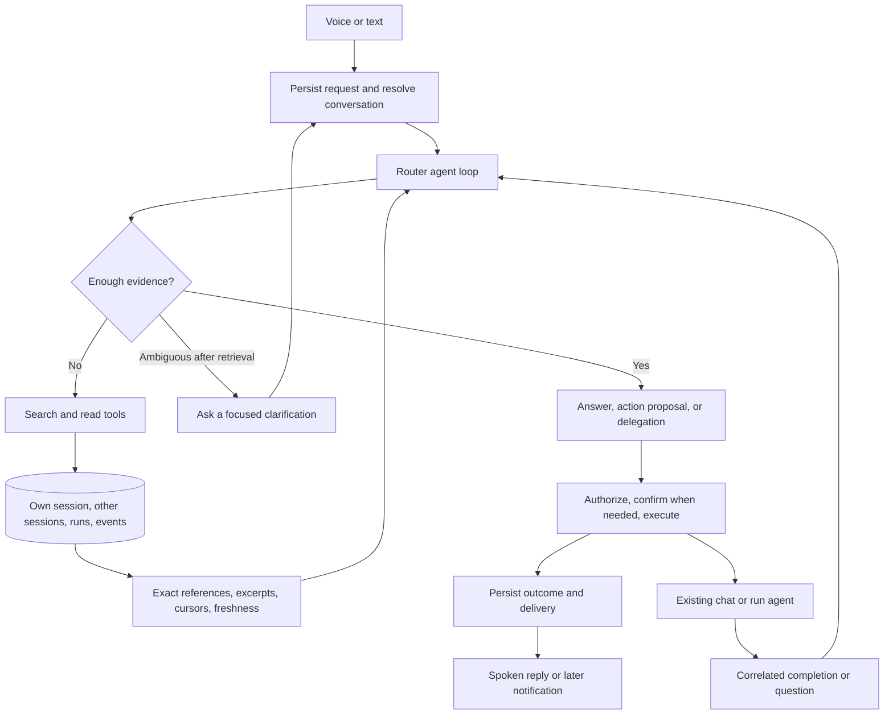

# Siri router context retrieval implementation plan

Implementation and validation status: [siri-context-implementation.md](siri-context-implementation.md). The subsequent request to make embeddings buildable supersedes the original FTS-only first-stage scope.

The Siri router must resolve a request by searching and reading the relevant evidence in its own session, other chat sessions, and protocol runs. Older messages remain accessible regardless of their position in a conversation. The router owns the user-facing conversation and can delegate substantial work to existing chat agents.

This plan replaces the fixed context selection and single extra read in the current planner with a persistent, tool-using router. Implementation starts from main with PR #63 included. This is the next stage of [the Siri agent design](siri-agent-design.md); its fixed-window and one-read assumptions are superseded by the requirements below.

## 1. Required behavior

- Find a decision hundreds of messages earlier in the router's own session.
- Find and inspect another run's conversation, including finished runs and archived sessions retained by the account.
- Follow session, message, run, and delegated-task references instead of guessing which object a phrase names.
- Search again, reformulate a query, read adjacent messages, and inspect corrections until the target and relevant facts are supported.
- Preserve original source records when compacting the model's working context. Every omitted excerpt remains reachable through a reference and continuation tool.
- Keep several requests and delegated tasks in progress without overwriting their context or pending questions.
- Acknowledge a slow request through the voice channel while the same durable request continues working.
- Distinguish a complete search with no matches from incomplete indexing, unavailable hosts, and stale mirrors.

Page sizes, token budgets, and resource controls may bound an individual operation. They must not define which retained history is eligible for retrieval. Resource exhaustion checkpoints the request and reports a resumable state; it does not invent an answer, start an unrelated chat, or silently claim that the evidence does not exist.

## 2. Current code and the changes it needs

| Existing code | Current behavior | Planned change |
| --- | --- | --- |
| `apps/server/src/services/siri/planner.ts` | Supplies eight exchange turns, ten recent chats, four open runs, and forty protocols; allows one `need` read; validates IDs against that snapshot. | Discover targets through tools, repeatedly retrieve evidence, and authorize resolved targets against their current records. |
| `apps/server/src/services/siri/warm.ts` | A shared conversational process per account, with a forty-turn restart and in-memory work queue. | Treat the model process as replaceable transport; isolate request conversations and restore their state from storage. |
| `apps/server/src/services/sessions/db.ts` | Stores full messages and durable events; reads the entire message list or a bounded session roster. | Add authenticated, indexed search and cursor-based reads, including the current Siri session and durable tool results. |
| `apps/server/src/services/runs/db.ts` | Stores run rows, snapshots, and ordered events linked to a session and host. | Add searchable run discovery, exact state reads, and paginated event reads. |
| `apps/server/src/services/deviceLink/mirror.ts` | Keeps desktop transcript copies on the box, with session, host, and account identity. | Search these records, report replication coverage, deduplicate copies, and fetch authoritative records when required. |
| `apps/server/src/services/siri/delivery.ts` | Posts results and settles a delegation through a Siri turn ID. | Correlate every return to a specific task/delegation; persist delivery state and deduplicate retries. |
| `apps/server/src/routes/siri.ts` | Races a request against HTTP/voice timeouts. | Admit a durable request, await its immediate result briefly, and leave continued work under a worker's ownership. |

## 3. Architecture and decisions

**Keep the existing TypeScript runtime and provider choices.** Implement an application-owned tool loop with a typed model output: a read-tool request, final response, clarification, action proposal, or delegation. Labee executes tools and supplies their results to the next model turn. This works over the existing Claude CLI and OpenAI adapters without requiring a framework migration or arbitrary shell access for the router. Native provider tool calling can later implement the same contract.

**Separate transcript, working context, and task state.** Original messages and durable events are the evidence store. A compact working context helps the model continue. Structured task records retain pending confirmations, resolved references, delegated work, and delivery status. A summary cannot replace a source or grant permission to execute an action.

**Give each router session an explicit execution owner.** A request remains attached to its original server/host. Device Link forwards reads and execution to the owner as needed. Changing the selected Mac does not silently migrate an active task. Cross-host discovery does not require sharing one mutable model conversation across hosts.

**Use full-text search first.** SQLite FTS5 already exists in this repository. Search original text and titles with structured filters and query reformulation. This first release does not require embeddings. Synonym and paraphrase cases belong in the evaluation set; add a semantic index if measured recall warrants it, while keeping exact source reads available.

## 4. Tool and data contracts

Define contracts in `packages/contracts/src/siri.ts`, exported from the package index. Implement retrieval under `apps/server/src/services/context/`; expose authenticated routes for Device Link and integration tests. The router calls the same service layer directly when the data is local.

| Tool | Inputs and behavior |
| --- | --- |
| `sessions.search` | Query plus optional session, host, time, status, archive, and run filters. Search the whole authorized corpus before ranking and pagination. Return matching message/event references and excerpts. Empty-query browsing also supports pagination. |
| `sessions.read` | Session reference plus message anchor or cursor and direction. Return ordered original messages, metadata, earlier/later cursors, and a stable snapshot boundary. |
| `messages.read` | Exact message reference plus content cursor/range. Retrieve the rest of a long message without an irreversible character cutoff. |
| `sessions.events` | Read durable tool calls, results, questions, and action events by turn or event cursor. Keep raw event results reachable even when normal transcript search excludes them for relevance. |
| `runs.search` | Query and structured filters across running, paused, finished, and abandoned runs. Include linked session and authoritative host references. |
| `runs.read` | Exact current run state, frozen protocol identity/snapshot reference, notes, and event cursors. Large snapshots and event bodies have continuation reads. |
| `protocols.search` / `protocols.read` | Reuse the protocol search/store services through the same authorized tool boundary; remove the forty-protocol roster as the universe of valid targets. |
| `tasks.read` | Inspect one router task's goal, evidence references, pending question, action receipts, and delegated work. Task discovery and event history are paginated. |

Action and delegation tools wrap the existing run/chat services; read tools never start work in another session. The model can request several independent reads in one turn. Dependencies remain sequential.

Every reference carries enough identity to reopen the source: authenticated account scope supplied by the server, origin host, session ID, message index or event sequence, and run ID where relevant. Account identity is never accepted as model-controlled authority.

Every retrieval response includes source references, timestamps/version information, cursors, and explicit coverage. Report `hasMore`, truncated content with a continuation, indexing progress, unavailable hosts, and mirror freshness separately. Use stable cursors/high-water marks so concurrent appends do not skip or duplicate history. An unknown or deleted anchor returns an explicit error, never an unrelated recent tail.

## 5. Implementation stages

### Stage 1 — Contracts and durable retrieval

1. Define the tool schemas, reference types, paging rules, and model-response union. Preserve the existing public `SayResult` fields while adding optional request/task IDs.
2. Add a derived context-document table and FTS5 index for transcript text, titles, durable evidence events, and run discovery. Keep source records authoritative; index rows point back to them.
3. Build cursor reads over `(session_id, idx)`, `(session_id, seq)`, and `(run_id, seq)`, with account checks before reading. Include same-session history explicitly.
4. Update indexing with source inserts/updates/deletions and mirror upserts. Add resumable backfill for existing data, index version tracking, and an explicit completeness watermark.
5. Cover account deletion, session deletion, archive/unarchive, mirror pruning, and renamed sessions. Rebuild from canonical data without changing original transcripts.
6. Implement exact-ID, phrase, keyword, time, protocol, and status lookup. Search retained archives when relevant; display archive status in results.

Files: `services/db.ts`, `services/sessions/db.ts`, `services/runs/db.ts`, `services/account.ts`, new `services/context/*`, contracts, and routes. Follow the repository's schema conventions; verify FTS behavior in both Bun and packaged Node SQLite runtimes.

**Exit:** a context tool finds a message at the start of a long session and can read every surrounding page and every part of a long message. New writes become searchable, deleted records disappear, and cross-account IDs/cursors yield no data.

### Stage 2 — Context across the box and Macs

1. Add one account-scoped discovery service over box-local records and desktop mirrors. A desktop queries that service and merges any newer local records.
2. Represent a canonical source separately from a mirrored copy. Deduplicate by account, origin host, session, and message/event identity.
3. Extend mirroring with explicit message/event high-water marks and coverage status. A mirror receipt timestamp alone is not evidence that the complete transcript was copied.
4. Reuse the existing HTTP tunnel for authoritative reads. Use an internal local-only scope so a forwarded request cannot recursively fan out again.
5. Search available mirrors while a host is offline, label the coverage, and retain unavailable source references for later retry. Actions requiring that host remain pending or report the host's unavailability.
6. Refactor executor dispatch to use resolved target ownership: box-owned run state, host-owned chat state, and fresh permission checks on every hop.

Files: `services/deviceLink/{mirror,client,protocol,hosts}.ts`, `routes/link.ts`, and `services/context/*`.

**Exit:** the router can discover a decision on another Mac, inspect its available mirror offline, and refresh it from the owner when online. Local and mirror duplicates do not produce two targets. Offline or partially replicated sources are never reported as a complete negative search.

### Stage 3 — Persistent requests and conversation state

1. Introduce durable router request, task, task-event, delegation, and action-receipt records. Keep several tasks open per router session; retain completed tasks as searchable history.
2. Store request status, model/tool checkpoints, evidence references, unresolved questions, pending confirmation plans, target versions, and delivery status. Store user-visible decisions and tool traces; no hidden model reasoning is needed.
3. Add request ownership, leases, and short atomic state transitions. Serialize conflicting task updates without holding an account-wide lock during slow retrieval/model work.
4. Migrate the legacy `lastBody.siri.open` exchange and pending confirmation idempotently. Preserve existing message indexes, turn IDs, and completed transcript records.
5. Give each delegation a unique ID and target turn/session reference. Multiple children returning under one original request must settle independently.
6. Admit newer user input during background work. Cancellation or a changed instruction advances the task version, preventing an older worker from applying its stale proposal.

**Exit:** restart restores a request and its pending confirmation; two requests can coexist; two delegated returns resolve the correct tasks; a cancelled or superseded request cannot execute later.

### Stage 4 — Router retrieval loop and model transport

1. Replace `gatherState` as the complete target inventory with a small bootstrap: latest input, router session, task references, explicit device/run references, and pending confirmations. Bootstrap previews expose continuation references.
2. Replace `Plan.need` and the two-call structure with repeated typed tool turns. Allow search, read, query reformulation, and additional reads until the agent can answer, propose an action, delegate, or explain an unresolved ambiguity.
3. Provide explicit instructions to investigate prior-context references, inspect surrounding messages and later corrections, and distinguish historical facts from current state.
4. Build working context against the selected model's token capacity. Pin the goal, pending question, unresolved targets, and evidence references. Compact older working material with links to originals; save the checkpoint before continuing.
5. Isolate transport conversations by account, router session, and task/request. Reuse a warm process only within compatible execution context. Process restarts and fallback providers rehydrate application-owned state; no decision relies on an opaque forty-turn model history.
6. Detect repeated identical tool calls that produce no new evidence. Reformulate or surface the unresolved issue. Resource controls pause/checkpoint progress rather than enforcing a fixed historical horizon or a one-read allowance.
7. Resolve and authorize IDs from tool evidence at execution time; remove membership in the initial snapshot as the validity rule. Keep action schemas and deterministic server validation.

Files: new `services/siri/{agent,context,tools,transport}.ts` (names may be consolidated), plus `planner.ts`, `warm.ts`, provider adapters, and fake model fixtures.

**Exit:** a scripted model must perform several dependent reads before it can identify the target; a fresh process with only persisted state succeeds as well. An old run outside all former roster limits is actionable after authorized retrieval.

### Stage 5 — Confirmation, execution, and durable delivery

1. Preserve the plain yes/no fast path when exactly one applicable pending confirmation exists. If several are plausible, resolve the conversational reference or ask which proposal the answer concerns.
2. Bind confirmation to the exact action arguments, target, task version, and relevant run/chat version. Revalidate before committing; changed state invalidates the affected proposal.
3. Add idempotency keys at the authoritative mutation endpoints. A persisted router receipt alone cannot prevent a duplicate mutation when a response is lost; retries must reuse the same key on the box/host that applies the action.
4. Move continued execution from an untracked promise into a durable worker. The HTTP handler awaits an immediate result within the existing voice budget and otherwise returns a working acknowledgment and request ID.
5. Persist delivery attempts and stable result IDs. Make the transcript/unread item idempotent; clients deduplicate repeated delivery IDs. Notification delivery is at-least-once, not a claimed exactly-once guarantee.
6. Retain the result's type after a delayed response: a late confirmation remains a question with its confirmation ID, not a generic completed notification. Carry source links, originating host, task, and delegation IDs through returns.
7. Reuse the current mobile and native Siri response shapes where possible. Add optional request IDs for retry safety in React Native and Swift, and verify delayed questions, Voice mode, unread catch-up, and notification actions.

Files: `routes/siri.ts`, `services/siri/delivery.ts`, run/chat mutation routes and services, `apps/mobile/src/api/siri.ts`, `apps/mobile/native/siri/ChatIntents.swift`, and `apps/mobile/targets/widgets/shared/LabeeAPI.swift`.

**Exit:** a delayed request survives restart and delivers the correct result/question. Repeated requests and a lost mutation response do not advance a run twice. The spoken outcome reflects the committed state.

### Stage 6 — Behavioral evaluation and rollout

Build deterministic integration tests with the existing fake-Claude and real-server harness. Extend the fake provider to emit sequences of tool calls and inspect the supplied evidence. Test outcomes and reachable history rather than copying internal implementation details.

| Scenario | Required result |
| --- | --- |
| Decision near the beginning of a 1,000-message Siri session | Find and read the source; later chat volume does not change the answer. |
| Prior run outside the ten most recent chats and four active runs | Discover the finished run and its original conversation. |
| More than 200 sessions, archived records, and an older protocol | Discovery is not restricted by existing list helpers or the forty-protocol preview. |
| Important text beyond a search excerpt or long-message prefix | Follow the continuation and recover the exact content. |
| A later correction contradicts the first matching message | Read the correction and use the applicable decision. |
| Several reads needed, including durable tool output | Continue retrieval beyond the former single `need` round. |
| Two similarly named runs | Use evidence to distinguish them or ask a specific question; never select by list position. |
| Two pending tasks and an ambiguous “yes” | No action executes until the intended confirmation is resolved. |
| State changes after confirmation; duplicate or lost-response retry | Reject stale execution; apply each authorized action at most once. |
| Mac offline, incomplete mirror, or indexing in progress | Report available evidence and incomplete coverage accurately. |
| Server/process restart during retrieval or delivery | Resume the same request without losing evidence or duplicating effects. |
| Another account's IDs, references, or cursor | No unauthorized source data or mutation. |

Run the affected server, mobile, and session-core suites and TypeScript checks. Build the bundled server and verify migrations/search on packaged Node as well as Bun. Use synthetic multi-session fixtures for live-provider evaluations: target selection, evidence correctness, retrieval coverage, clarification quality, first spoken response, completion latency, and token cost. Measure semantic-query misses before deciding on embeddings.

Acceptance requires every deterministic scenario above to pass, no cross-account access or duplicate actions, and a live-provider report that identifies the exact expected target/evidence for each case. Set latency and recall release thresholds from the recorded baseline and review the failures; do not substitute fabricated confidence scores for evidence.

Roll out in this order:

1. Ship additive schema, index/backfill, and read tools behind a capability flag.
2. Exercise retrieval on synthetic/staging data with mutations disabled.
3. Enable the router for the development account and complete physical-device confirmation, late-response, and offline-host checks.
4. Publish any required app update for request/delivery IDs, then enable the server feature for supported clients.
5. Enable more accounts after evaluating the traces and failure cases. Preserve a feature rollback and database compatibility; pausing the new router must preserve its outstanding tasks and pending confirmations.

Update `siri-agent-design.md` to describe the implemented loop, remove superseded fixed-window assumptions, and link this plan's acceptance evidence. Open implementation PRs by stage in dependency order. No automatic production deployment is implied by completing the plan.

## 6. Research basis

- [Hermes session search](https://hermes-agent.nousresearch.com/docs/user-guide/sessions): search original conversations and read/scroll around identified messages. Labee additionally requires its active session to be an explicit searchable source.
- [OpenClaw session search](https://docs.openclaw.ai/concepts/session-search) and [history tools](https://docs.openclaw.ai/concepts/session-tool): discover sessions, reopen anchored matches, page history, and report visibility/coverage.
- [OpenAI Agents SDK orchestration](https://developers.openai.com/api/docs/guides/agents/orchestration) and [sandbox memory](https://developers.openai.com/api/docs/guides/agents/sandboxes): a coordinator retains the response while using specialists; progressive disclosure keeps detail available on demand.
- [Dots tasks and memory](https://learn.chatgpt.com/docs/dots/tasks-and-memory) and [Muse design](https://introducing.muse.ai/): product references for a persistent main conversation and separately coordinated tasks. Their public descriptions do not establish a transcript-search algorithm to reproduce.

These sources inform the design. The schemas, persistence model, device behavior, and acceptance cases above are Labee-specific decisions.
